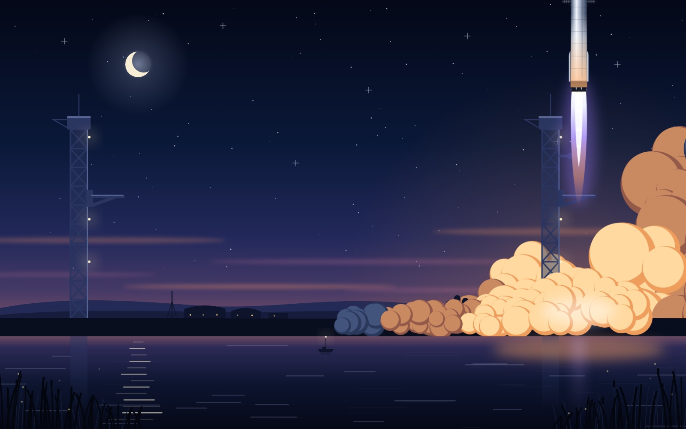
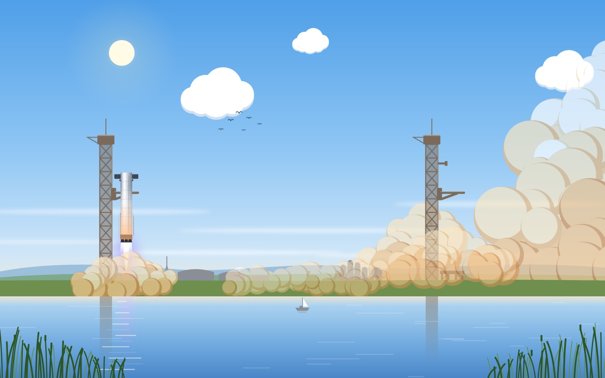

# Starship theme

An animated Starship launch as a theme for the Claude desktop and mobile apps. A rocket stands by its tower, ignites, and climbs out of the top of the window on a violet flame while cartoon smoke boils up round the pad. Later its booster falls back in on the other side, brakes, and is caught in the arms of a second tower. The whole flight repeats every 60 seconds.

Around the flight there are stars, a crescent moon and a shooting star (or a sun, clouds and birds by day), far hills, hangars, a tank farm, a boat at anchor, reeds and fireflies, all mirrored in still water. The theme also sets a matching palette for the window.





## Install

At the prompt of a terminal session:

```
/plugin install starship-theme --marketplace LongHuynh-vn/starship-theme
```

From a shell:

```
claude plugin install starship-theme --marketplace LongHuynh-vn/starship-theme
```

In the desktop app, where `/plugin` does not run: click + next to the prompt box, then Plugins, Add marketplace with `LongHuynh-vn/starship-theme`, then Add plugin.

The theme goes on by itself when a session starts.

## Use

| Command | What it does |
| --- | --- |
| `/starship` | Lists the looks, the layouts and the blur setting, and marks the current ones |
| `/starship dusk` | The launch at dusk, for a dark window (the default) |
| `/starship day` | The same launch under a blue sky, for a light window |
| `/starship layout panels` | Runs the flight right beside the conversation, in view with the sidebar and the side panel open (the default) |
| `/starship layout wide` | Runs the flight out in the window's far margins, with a bigger rocket, for when the panels are closed |
| `/starship blur on` | Frosts the panel behind the conversation so text reads more clearly; `blur off` clears it |
| `/starship off` | Takes the theme off, back to the app's own look |

Every choice is saved, so new sessions start with it.

## Notes

- The backdrop draws in the Claude desktop and mobile apps. A terminal or an editor draws no theme.
- One theme stands at a time, so another mod that sets a theme will replace this one, or be replaced by it.
- With your system's reduced-motion setting on, the scene is still: the rocket stands on its pad.
- This is fan art of a rocket launch. It is not affiliated with or endorsed by SpaceX.

## Develop

```
claude plugin validate .
claude plugin test .
```

The scene is one SVG per look and layout, built as a string in `hooks/starship.ts` and animated by its own CSS. `hooks/make-colors.js` is the palette helper that ships with Claude Code's mod-authoring skill, copied as it is.
